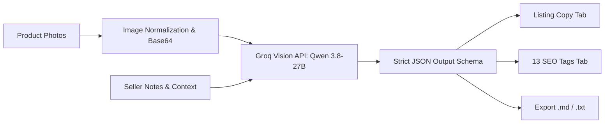

# 📦 ListingCraft AI

> **AI-Powered Product Listing & Marketplace SEO Generator**  
> Turn product photos into high-converting descriptions, optimized titles, and 13 targeted search tags using hosted open-weight Vision Language Models (VLMs) on Groq.

[](https://www.python.org/)
[](https://streamlit.io/)
[](https://groq.com/)
[](LICENSE)

---

## 🌟 Highlights & Features

- **👁️ Multimodal Visual Appraisal**: Analyzes uploaded product photos to identify materials, textures, colors, flaws, craft style, and unique selling points using state-of-the-art vision models (`qwen/qwen3.8-27b`) hosted on Groq.
- **🎯 Multi-Marketplace Optimization**:
  - **Etsy**: Keyword-dense 140-character titles, storytelling descriptions, and 13 exact search tags for maximum discovery placement.
  - **eBay**: Spec-focused titles, condition notes, dimensions, and structured item specifics.
  - **Shopify**: Brand-centric copy, value proposition bullets, and customer benefit framing.
  - **Instagram / Social Shop**: Catchy hooks, aesthetic styling, emoji accents, and viral discovery tags.
- **🏷️ 13 High-Traffic SEO Tags**: Generates 13 algorithm-targeted search tags displayed as interactive badges, with a 1-click comma-separated string ready for instant copy-pasting.
- **📝 Live Copy Editing**: Review and edit generated titles with real-time character count indicators and inspect formatted markdown descriptions.
- **💾 One-Click Export**: Export your complete listing package directly as clean `.md` or `.txt` files.
- **🔒 Enterprise-Grade Key Isolation**: Zero API key exposure to visitors. The app securely resolves keys from backend server secrets or environment variables.

---

## 🏗️ Architecture & Workflow



---

## 🚀 Quickstart Guide

### 1. Clone the Repository
```bash
git clone https://github.com/Sangam067/ListingCraftAI.git
cd ListingCraftAI
```

### 2. Set Up Virtual Environment (Optional but Recommended)
```bash
# macOS/Linux
python3 -m venv venv
source venv/bin/activate

# Windows
python -m venv venv
venv\Scripts\activate
```

### 3. Install Dependencies
```bash
pip install -r requirements.txt
```

### 4. Configure Your Groq API Key
Obtain a free API key at [console.groq.com/keys](https://console.groq.com/keys).

**Option A (Recommended for Streamlit):**
Copy `.streamlit/secrets.toml.example` to `.streamlit/secrets.toml`:
```toml
# .streamlit/secrets.toml
GROQ_API_KEY = "gsk_your_actual_key_here"
```

**Option B (Environment Variable):**
```bash
# Linux/macOS
export GROQ_API_KEY="gsk_your_actual_key_here"

# Windows (PowerShell)
$env:GROQ_API_KEY="gsk_your_actual_key_here"

# Windows (CMD)
set GROQ_API_KEY=gsk_your_actual_key_here
```

### 5. Launch the Application
```bash
streamlit run app.py
```
Open your browser and navigate to `http://localhost:8501`.

---

## 📁 Repository Structure

```
ListingCraftAI/
├── .streamlit/
│   └── secrets.toml.example    # Configuration template (secrets.toml is git-ignored)
├── app.py                      # Complete Streamlit application
├── requirements.txt            # Project dependencies
├── .gitignore                  # Git ignore rules protecting secrets & temp files
└── README.md                   # Project documentation
```

---

## 🛡️ Security & Privacy Notice

- **No Secrets in Code**: Secrets are never hardcoded or shown in client interfaces.
- **`.gitignore` Enforced**: `.streamlit/secrets.toml`, `.env`, and all credentials files are strictly excluded from git tracking.
- Images uploaded are processed in-memory as Base64 URIs and are never written to permanent disk storage.

---

## 📄 License

This project is licensed under the [MIT License](LICENSE).
